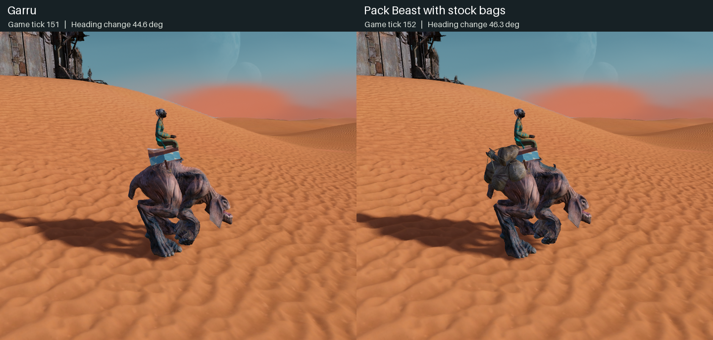

# Meitou v0.22.1 compatibility trial

Tested on 2026-11-24 with official Windows x64 MeitouClient `0.22.1+9ee4074bbc6fd7fdeb26108a04afc9f90cb1dc01`, mod API 2 and .NET SDK 11.0.100. The release archive digest and all 260 extracted files were verified. [Environment](evidence/v0.22.1/environment.json).

Candidate `0.3.0-playtest.6` updates the game pin, build defaults, verifier pin and instructions. No runtime C# changes were needed. Schema 3, pack and save IDs, the released descriptor, saddle art and point-to-point boat controls are unchanged. The tested candidate is published as playtest.6; playtest.5 remains available for v0.20.1.

## Garru and Pack Beast

The same Linux-authored Garru Saddle ZIP used for the published playtest.5 was installed byte for byte. Both runs used the actual v0.22.1 game renderer and native movement, with a separate observation driver and isolated profiles.

| Animal | Posed frames on route | Turn frames | Heading change | Max saddle error, full run | Max pelvis error, full run |
| --- | ---: | ---: | ---: | ---: | ---: |
| Garru | 117 | 41 | 91.4 degrees | 0.00873 | 0.01611 |
| Pack Beast with stock bags | 112 | 41 | 93.0 degrees | 0.00873 | 0.02376 |

Errors are world units and must remain below 0.08. During the initial turn, the Pack Beast pelvis maximum was 0.01611; the full-run maximum includes the remount and camera excursion. Both animals passed walking, running, the turn, saving while mounted, reloading on foot beside the original animal, remounting, dismounting and an ordinary on-foot order. The existing Stoat driver also exercised the Domesticated Bull.

All 112 initial Pack Beast poses included the stock luggage mesh. After reload the original bag (`4002-gamedata.base`) and three inventory entries survived. Camera travel produced five consecutive frames without the carrier or saddle, then eight aligned frames with exactly one saddle. There were no rider-only or carrier-only frames during that excursion. As before, the isolated bagged trial disabled the squad camera leash.

[Before the turn](evidence/v0.22.1/turn-before.png) · [After the turn](evidence/v0.22.1/turn-after.png) · [Frame pairings](evidence/v0.22.1/frame-pairs.tsv) · [Garru trace](evidence/v0.22.1/stoat.txt) · [Pack Beast trace](evidence/v0.22.1/stoat-bags.txt).

The art limitation remains visible: the rigid saddle sits high; the stock bags overlap or obscure part of the saddle and lower leg. Passing attachment measurements do not establish a clipping-free fit. No offsets or art were changed to improve the numerical result.

## Western Hive and simulation

- Framework alone: zero vessels and zero transport actions. [Trace](evidence/v0.22.1/core.txt).
- Fresh voyage: exactly one automatic skiff at `-120780, -17640` before player arrival; board, steer, sail over 70 units, save while moving, reload the empty helm at its saved pose, remain stationary for 30 ticks, reboard, disembark and move normally. [Trace](evidence/v0.22.1/example.txt).
- Previous save: replayed the same preserved Western Hive slot used by the v0.20.1 acceptance run. The saved hull remained at its saved pose, with no duplicate at the anchorage, then completed another voyage and save/reload cycle. The input save was copied into the isolated profile. [Trace](evidence/v0.22.1/old-save.txt).
- One and four workers: all 333 voyage tick hashes and 216 riding tick hashes match. The existing rotated-bone/two-carrier-size, blocked exit, forced release, shallow-water, pack discovery and save tests pass. [Simulation output](evidence/v0.22.1/simulation.txt).

These are functional checks on Windows, not a performance benchmark or native Linux gameplay test. The offscreen runs logged an NVIDIA Streamline `presentCommon()` warning during loading; it did not prevent the recorded checks from completing. Historical v0.20.1 measurements remain in [the previous report](playtest-5.md).

Released Maestro v0.1.0-playtest.1 still requires v0.20.1 readers for authoring. The authored schema-3 pack is consumed by Transport on v0.22.1; upgrading the editor readers is outside this change. [Repeat the trials](../tests/LiveVoyage/README.md).
